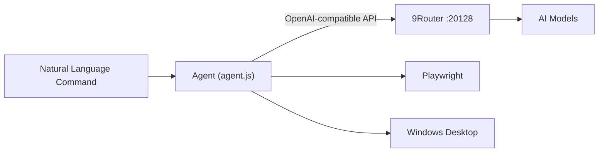

<div align="center">

# Agent Automation

**Windows desktop and browser automation controlled through natural-language commands.**

Automates desktop interaction, browser tasks, file management, and other workflows through an AI agent.
Uses [9Router](https://github.com/decolua/9router) as the LLM gateway with automatic model fallback.


[Fitur](#fitur) • [Cara Kerja](#cara-kerja) • [Instalasi](#instalasi) • [Perintah](#contoh-perintah) • [Konfigurasi](#konfigurasi) • [Keamanan](#keamanan)

</div>

---

## Fitur

| Kemampuan           | Deskripsi                                                                                                   |
| ------------------- | ----------------------------------------------------------------------------------------------------------- |
| File & Folder       | Mencari folder, melihat isi direktori, serta membuka file, folder, dan aplikasi.                            |
| Screen Capture      | Mengambil screenshot layar dan mengirimkannya ke model untuk dianalisis.                                    |
| Desktop Control     | Mengontrol mouse dan keyboard, termasuk klik, scroll, pengetikan, dan kombinasi tombol.                     |
| Browser Automation  | Membuka website, membaca halaman, mengisi form, melakukan klik, dan mengunggah file menggunakan Playwright. |
| YouTube             | Mencari dan memutar video berdasarkan perintah teks.                                                        |
| Model Fallback      | Menggunakan 9Router untuk berpindah ke model lain ketika provider utama mencapai limit atau tidak tersedia. |
| Automatic Setup     | Menyiapkan Node.js, dependencies, Chromium, dan 9Router melalui satu launcher.                              |
| Automatic Updates   | Memeriksa versi terbaru dan memperbarui file project secara otomatis.                                       |
| Action Confirmation | Meminta konfirmasi sebelum melakukan aksi fisik pada komputer.                                              |

---

## Cara Kerja



Alur utama:

1. User memberikan perintah menggunakan bahasa biasa.
2. Agent mengirimkan perintah dan daftar tools yang tersedia ke model melalui 9Router.
3. Model menentukan tool yang diperlukan untuk menyelesaikan tugas.
4. Agent menjalankan tool tersebut pada Windows atau browser.
5. Hasil eksekusi dikirim kembali ke model.
6. Proses berlanjut sampai tugas selesai.

Agent tidak membutuhkan command khusus untuk setiap tindakan. User cukup menjelaskan apa yang ingin dilakukan.

---

## Instalasi

### Requirements

* Windows 10 atau Windows 11
* Koneksi internet
* Akses ke repository project

Node.js, dependencies, Chromium, dan 9Router dapat dipasang secara otomatis oleh launcher.

### Setup

Download `start-agent.bat`, kemudian letakkan file tersebut di folder pilihan, misalnya Desktop atau Downloads.

Jalankan:

```text
start-agent.bat
```

Pada penggunaan pertama, launcher akan:

* Membuat folder `Agent Automation`.
* Memeriksa dan memasang Node.js jika diperlukan.
* Memasang npm dependencies.
* Memasang browser Chromium.
* Memasang dan menjalankan 9Router.
* Meminta API key 9Router.
* Menyimpan konfigurasi untuk penggunaan berikutnya.

Setelah setup selesai, jalankan `start-agent.bat` kembali untuk memulai agent.

### 9Router

Setidaknya satu provider harus terhubung melalui dashboard 9Router.

Dashboard default:

```text
http://localhost:20128/dashboard
```

Buat combo dengan nama:

```text
bot-combo
```

Gunakan strategi:

```text
Fallback
```

---

## Contoh Perintah

Agent menerima perintah menggunakan bahasa natural.

```text
cari folder bernama Laporan lalu buka

aku pengen nonton youtube, cariin video weak hero

buka notepad, lalu ketik "catatan rapat hari ini"

ambil screenshot lalu jelaskan apa yang terlihat di layar

buka https://situs-tujuan.com/upload lalu upload file laporan.pdf
```

Tidak perlu menyebut nama tool secara manual. Agent akan menentukan tool yang sesuai berdasarkan perintah.

---

## Tools

<details>
<summary><b>Daftar Tools</b></summary>

### Desktop

| Tool            | Fungsi                                        |
| --------------- | --------------------------------------------- |
| `find_folder`   | Mencari folder berdasarkan nama.              |
| `list_dir`      | Melihat isi direktori.                        |
| `open_path`     | Membuka folder, file, atau aplikasi.          |
| `screenshot`    | Mengambil screenshot layar.                   |
| `click_screen`  | Melakukan klik berdasarkan koordinat layar.   |
| `scroll_screen` | Melakukan scroll pada layar.                  |
| `type_desktop`  | Mengetik teks menggunakan keyboard.           |
| `press_keys`    | Menekan tombol atau kombinasi keyboard.       |
| `wait`          | Menunggu proses atau aplikasi selesai dimuat. |

### Browser

| Tool            | Fungsi                             |
| --------------- | ---------------------------------- |
| `open_url`      | Membuka URL.                       |
| `inspect_page`  | Memeriksa struktur halaman web.    |
| `get_page_text` | Mengambil teks dari halaman.       |
| `type_text`     | Mengisi input pada halaman.        |
| `click`         | Mengklik elemen browser.           |
| `upload_file`   | Mengunggah file melalui browser.   |
| `youtube_play`  | Mencari dan memutar video YouTube. |

### General

| Tool         | Fungsi                                         |
| ------------ | ---------------------------------------------- |
| `list_files` | Melihat file yang tersedia pada folder upload. |
| `done`       | Menandai tugas sebagai selesai.                |

</details>

---

## Konfigurasi

Konfigurasi disimpan di:

```text
Agent Automation/config.bat
```

| Variable       | Default                     | Description                                    |
| -------------- | --------------------------- | ---------------------------------------------- |
| `ROUTER_KEY`   | Setup                       | API key dari 9Router.                          |
| `ROUTER_URL`   | `http://localhost:20128/v1` | Endpoint API 9Router.                          |
| `ROUTER_MODEL` | `bot-combo`                 | Combo atau model yang digunakan.               |
| `SAFE_DIR`     | `upload-folder`             | Direktori yang diizinkan untuk browser upload. |
| `CONFIRM`      | `1`                         | Meminta konfirmasi sebelum aksi fisik.         |
| `SEARCH_ROOTS` | User folders                | Direktori tambahan untuk pencarian.            |
| `UPDATE_URL`   | Optional                    | Source untuk automatic updates.                |

### Configuration Commands

Reset API key:

```cmd
start-agent.bat reset
```

Mengatur update source:

```cmd
start-agent.bat seturl
```

---

## Automatic Updates

Saat dijalankan, launcher memeriksa `version.txt` lokal dan membandingkannya dengan versi yang tersedia pada update source.

Jika versi berbeda:

1. File yang tercantum di `files.txt` akan diunduh.
2. File project diperbarui.
3. Jika `package.json` berubah, npm dependencies akan dipasang kembali.
4. Agent kemudian dijalankan menggunakan versi terbaru.

Jika update gagal atau koneksi internet tidak tersedia, versi lokal tetap digunakan.

Format update source:

```text
https://raw.githubusercontent.com/NAMAKAMU/NAMAREPO/main
```

### Releasing a New Version

Untuk merilis perubahan:

1. Update file project di repository.
2. Update nomor versi pada `version.txt`.
3. Pastikan file yang perlu diperbarui tercantum di `files.txt`.
4. Push perubahan ke repository.

---

## Struktur Repository

```text
.
├── start-agent.bat
├── agent.js
├── package.json
├── version.txt
├── files.txt
└── README.md
```

| File              | Fungsi                                   |
| ----------------- | ---------------------------------------- |
| `start-agent.bat` | Installer, updater, dan launcher.        |
| `agent.js`        | Program utama agent.                     |
| `package.json`    | Node.js dependencies.                    |
| `version.txt`     | Nomor versi project.                     |
| `files.txt`       | Daftar file yang digunakan untuk update. |
| `README.md`       | Dokumentasi project.                     |

---

## Keamanan

Agent memiliki akses untuk melakukan berbagai tindakan pada komputer. Pastikan hanya menjalankannya pada environment yang dipercaya.

### Action Confirmation

Konfirmasi aksi aktif secara default:

```text
CONFIRM=1
```

Agent akan meminta persetujuan sebelum melakukan tindakan seperti:

* Klik
* Mengetik
* Membuka file atau aplikasi
* Upload file

Untuk menjalankan tanpa konfirmasi:

```text
CONFIRM=0
```

Gunakan mode tersebut hanya jika environment dan workflow sudah dipercaya.

### Data Privacy

Screenshot yang digunakan oleh agent dapat dikirim ke provider model yang dipilih melalui 9Router.

Hindari menjalankan agent ketika layar menampilkan:

* Password
* Informasi perbankan
* Token atau API key
* Percakapan pribadi
* Data sensitif lainnya

### API Key

API key disimpan sebagai plain text di `config.bat`.

Jangan membagikan file tersebut atau memasukkannya ke repository publik.

### Automatic Updates

Karena launcher dapat mengunduh dan menjalankan file dari update source, gunakan repository yang kamu kontrol dan percaya.

Aktifkan 2FA pada akun GitHub dan jangan menggunakan update source yang tidak dikenal.

### Third-Party Providers

Beberapa provider atau model yang tersedia melalui 9Router dapat memiliki batasan atau ketentuan penggunaan tertentu.

Periksa terms of service provider sebelum menggunakan project untuk kebutuhan komersial atau production.

---

## Troubleshooting

| Masalah                                 | Solusi                                                                                       |
| --------------------------------------- | -------------------------------------------------------------------------------------------- |
| Node.js belum terbaca setelah instalasi | Tutup terminal atau window yang sedang terbuka, kemudian jalankan `start-agent.bat` kembali. |
| API key ditolak                         | Jalankan `start-agent.bat reset`, kemudian masukkan API key yang benar.                      |
| Agent hanya menghasilkan rencana        | Gunakan model yang mendukung tool calling dan memiliki kemampuan yang sesuai di combo.       |
| Klik tidak tepat                        | Gunakan model dengan vision support dan minta agent mengambil screenshot terbaru.            |
| 9Router tidak merespons                 | Buka `http://localhost:20128/dashboard` dan pastikan service 9Router sedang berjalan.        |

---

## Limitations

Agent bergantung pada model AI yang digunakan untuk menentukan tindakan.

Hasil dapat berbeda tergantung pada:

* Kemampuan tool calling model.
* Kemampuan vision model.
* Kondisi halaman web.
* Perubahan UI aplikasi.
* Koneksi internet.
* Ketersediaan provider melalui 9Router.

Untuk tugas yang melibatkan data penting atau tindakan yang tidak dapat dibatalkan, gunakan confirmation mode.

---

## Disclaimer

This project is provided as-is without warranty.

The user is responsible for actions performed by the agent, configuration of connected services, API usage, and compliance with the terms of service of any third-party provider or model used with the project.

---

<div align="center">

**Agent Automation**

Built with [9Router](https://github.com/decolua/9router) and [Playwright](https://playwright.dev).

</div>
