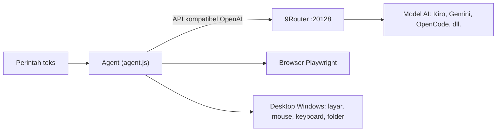

<div align="center">

# 🤖 Agent Automation

**Agent AI yang bisa mengontrol PC Windows dan browser lewat perintah teks biasa.**
Setup otomatis. Update otomatis. Model AI murah atau gratis lewat [9Router](https://github.com/decolua/9router).


[Fitur](#-fitur) • [Cara Kerja](#-cara-kerja) • [Instalasi](#-instalasi-cepat) • [Contoh Perintah](#-contoh-perintah) • [Konfigurasi](#-konfigurasi) • [Keamanan](#-keamanan)

</div>

---

## ✨ Fitur

| | Kemampuan | Keterangan |
|---|---|---|
| 🗂️ | **Kelola folder dan file** | Cari folder dan file di semua drive, lihat isinya, buka, atau upload dari lokasi mana pun |
| 👁️ | **Melihat layar** | Mengambil screenshot dan mengirimnya ke model agar agent tahu apa yang tampil |
| 🖱️ | **Mouse dan keyboard** | Klik, double-klik, klik kanan, scroll, mengetik, dan menekan tombol |
| 🌐 | **Otomasi browser** | Buka website, isi form, klik tombol, dan upload file memakai Playwright |
| ▶️ | **YouTube instan** | Cari lalu putar video otomatis hanya dengan menyebut judulnya |
| 🔁 | **Fallback model** | Lewat 9Router, otomatis pindah model jika satu provider kena limit |
| ⚙️ | **Setup satu klik** | Satu file `.bat` memasang Node.js, dependensi, Chromium, dan 9Router |
| ⬆️ | **Update otomatis + notifikasi** | Alamat update sudah bawaan. Versi baru diunduh sendiri, lengkap dengan pengumuman dan daftar perubahan |
| 🛡️ | **Minta izin dulu** | Setiap aksi fisik (klik, ketik, buka, upload) menunggu persetujuan `y/n` |

---

## 🧩 Cara Kerja



1. Kamu mengetik perintah dengan bahasa biasa.
2. Agent mengirim perintah ke model AI lewat 9Router, bersama daftar "alat" yang boleh dipakai.
3. Model memilih alat (misalnya `find_folder`, `screenshot`, `click_screen`), agent menjalankannya, lalu hasilnya dikembalikan ke model.
4. Langkah diulang sampai tugas selesai.

---

## 🚀 Instalasi Cepat

**Prasyarat:** Windows 10 atau 11 dan koneksi internet. Selebihnya dipasang otomatis.

1. Download [`start-agent.bat`](start-agent.bat) (klik **Download raw file** di pojok kanan atas halaman file).
2. Taruh di folder mana saja, misalnya Desktop atau Downloads.
3. Klik dua kali.

Pada jalan pertama, skrip akan:

- membuat folder `Agent Automation` di sebelah file `.bat`
- memasang **Node.js** (jika belum ada), dependensi npm, dan browser **Chromium**
- memasang dan menjalankan **9Router**
- meminta **API key** 9Router sekali saja lalu menyimpannya (dilewati jika owner menyediakan akses AI, lihat [Mode Owner](#-mode-owner-akses-ai-dibagikan))

Mulai jalan berikutnya, cukup klik dua kali dan agent langsung siap.

> **Catatan:** hubungkan minimal satu provider di dashboard 9Router (`http://localhost:20128/dashboard`) dan buat combo bernama `bot-combo` dengan strategi **Fallback**.

---

## 💬 Contoh Perintah

Tulis dengan bahasa sehari-hari. Tidak perlu menyebut nama alat.

```text
Perintah> cari folder bernama Laporan lalu buka
Perintah> aku pengen nonton youtube, cariin video weak hero
Perintah> buka notepad, lalu ketik "catatan rapat hari ini"
Perintah> ambil screenshot lalu jelaskan apa yang terlihat di layar
Perintah> buka https://situs-tujuan.com/upload lalu upload file laporan.pdf
```

---

## 🛠️ Alat yang Tersedia

<details>
<summary><b>Lihat daftar lengkap</b></summary>

| Kelompok | Alat | Fungsi |
|---|---|---|
| Desktop | `find_folder`, `list_dir`, `open_path` | Mencari, melihat isi, dan membuka folder, file, atau aplikasi |
| Desktop | `screenshot` | Mengambil gambar layar untuk dilihat model |
| Desktop | `click_screen`, `scroll_screen` | Klik dan scroll berdasarkan koordinat screenshot |
| Desktop | `type_desktop`, `press_keys` | Mengetik teks dan menekan kombinasi tombol |
| Desktop | `wait` | Menunggu aplikasi atau halaman selesai dimuat |
| Browser | `open_url`, `inspect_page`, `get_page_text` | Membuka dan membaca halaman web |
| Browser | `type_text`, `click`, `upload_file` | Mengisi form, klik, dan upload file |
| Browser | `youtube_play` | Mencari dan memutar video YouTube |
| Umum | `list_files`, `done` | Melihat folder upload dan menandai tugas selesai |

</details>

---

## ⚙️ Konfigurasi

Pengaturan disimpan otomatis di `config.bat` dalam folder `Agent Automation`.

| Variabel | Default | Fungsi |
|---|---|---|
| `ROUTER_KEY` | (diisi saat setup) | API key dari 9Router |
| `ROUTER_URL` | `http://localhost:20128/v1` | Alamat endpoint 9Router |
| `ROUTER_MODEL` | `bot-combo` | Nama combo atau model yang dipakai |
| `SAFE_DIR` | `upload-folder` | Folder default untuk nama file relatif. Bukan pembatas: upload bisa dari lokasi mana pun |
| `AUTO_UPDATE` | `1` | `0` = matikan update otomatis dan notifikasinya |
| `CONFIRM` | `1` | `1` = minta izin sebelum aksi fisik, `0` = otomatis penuh |
| `SEARCH_ROOTS` | folder pengguna | Folder tambahan untuk pencarian, dipisah titik koma |
| `UPDATE_URL` | (bawaan owner) | Ganti sumber update. Biasanya tidak perlu diisi |

**Perintah tambahan:**

```cmd
start-agent.bat reset     :: hapus key dan isi ulang
start-agent.bat seturl    :: ganti alamat update (lanjutan)
```

---

## ⬆️ Update Otomatis

Alamat update **sudah tertanam** di `start-agent.bat`. User tidak perlu memasukkan URL apa pun.

| Kapan | Yang terjadi |
|---|---|
| Setiap `start-agent.bat` dijalankan | Versi dicek. Jika ada yang baru, file diunduh otomatis, `npm install` dijalankan bila perlu, lalu **daftar perubahan** ditampilkan |
| Saat agent sedang berjalan | Dicek tiap 15 menit. Jika ada versi baru muncul pemberitahuan `*** UPDATE TERSEDIA ***` |
| User mengetik `/update` | Agent menutup dirinya, memperbarui, dan menyala lagi otomatis |
| Owner menulis `notice.txt` | **Pengumuman** tampil di layar semua user setiap kali agent dijalankan |

Jika internet mati atau unduhan gagal, agent tetap jalan dengan versi lokal dan mencoba lagi lain kali. User yang tidak mau update otomatis cukup menulis `AUTO_UPDATE=0` di `config.bat`.

### Untuk Owner: merilis versi baru

1. Ganti `agent.js` di repo ini (**Add file → Upload files**).
2. Naikkan angka di `version.txt` (misalnya `3` menjadi `4`). **Angka inilah yang memicu update ke semua user.**
3. (Opsional) Tulis perubahannya di `changelog.txt`. Isinya tampil ke user setelah update.
4. (Opsional) Tulis pengumuman di `notice.txt`. Kosongkan lagi jika sudah tidak perlu.
5. **Commit changes.** GitHub kadang menyimpan cache hingga sekitar 5 menit.

Untuk menambah file baru ke update, tambahkan namanya ke `files.txt` (satu nama per baris, tanpa folder). `config.bat` dan `start-agent.bat` sengaja tidak bisa ditimpa oleh update.

---

## 🔑 Mode Owner: akses AI dibagikan

Secara bawaan setiap user memakai 9Router di PC-nya sendiri dan memasukkan key sendiri. Jika owner ingin user **tidak perlu memasang 9Router dan tidak perlu memasukkan key**, owner menjalankan satu server 9Router yang bisa diakses internet, lalu mengisi dua baris di bagian atas `start-agent.bat` sebelum membagikannya:

```bat
set "OWNER_ROUTER_URL=https://ai.domainmu.com/v1"
set "OWNER_ROUTER_KEY=sk-key-untuk-user"
```

Dengan itu `start-agent.bat` melewati pemasangan 9Router dan langsung memakai server owner.

> ⚠️ **Jangan pernah menaruh key di repo GitHub publik.** Isi hanya di file `start-agent.bat` yang dibagikan langsung ke user. Key lokal `localhost` milik satu PC tidak berlaku di PC lain, jadi mode ini membutuhkan server bersama.
>
> ⚠️ **Amankan server.** Ganti password dashboard 9Router, jangan membuka dashboard ke internet (cukup jalur `/v1`), gunakan key terpisah per user supaya bisa dicabut satu per satu, dan pantau pemakaian.
>
> ⚠️ **Transparansi ke user:** perintah dan screenshot layar user melewati server owner. Beri tahu user soal ini. Pastikan juga penggunaan akun/provider yang dibagikan sesuai ketentuan layanan masing-masing.

---

## 📁 Struktur Repo

```text
.
├── start-agent.bat   # Installer + launcher (klik dua kali)
├── agent.js          # Program agent
├── package.json      # Dependensi
├── version.txt       # Nomor versi (angka yang berubah = memicu update)
├── files.txt         # Daftar file yang diunduh saat update
├── changelog.txt     # Daftar perubahan, tampil ke user setelah update
├── notice.txt        # Pengumuman owner, tampil ke semua user
└── README.md
```

---

## 🔐 Keamanan

Agent ini punya kontrol luas atas PC. Pakai dengan sadar.

- ✅ **Izin `y/n`** aktif secara default untuk setiap klik, ketikan, pembukaan file, dan upload.
- ✅ **Tidak ada alat untuk menjalankan perintah shell bebas.**
- ✅ **Berhenti kapan saja** dengan menekan `Ctrl + C`.
- ⚠️ **Screenshot dikirim ke penyedia model** yang kamu pilih. Jangan jalankan agent saat layar menampilkan password, internet banking, atau percakapan pribadi.
- ⚠️ **API key tersimpan sebagai teks biasa** di `config.bat`. Jangan membagikan folder `Agent Automation`.
- ⚠️ **Siapa pun yang bisa mengubah repo sumber update bisa mengubah kode yang berjalan di PC-mu.** Aktifkan verifikasi dua langkah (2FA) di akun GitHub dan hanya pakai repo milikmu sendiri.
- ⚠️ Beberapa jalur gratis di 9Router tidak resmi dan bisa melanggar ketentuan penyedianya. Periksa sebelum dipakai untuk keperluan bisnis.

---

## 🩺 Pemecahan Masalah

| Masalah | Solusi |
|---|---|
| `Node.js belum terbaca` setelah instalasi | Tutup jendela, lalu klik dua kali `start-agent.bat` lagi |
| `Akses ditolak oleh server owner` | Key dicabut atau salah. Minta `start-agent.bat` baru dari owner |
| `Key ditolak oleh 9Router` | Jalankan `start-agent.bat reset` dan masukkan key yang benar |
| Agent hanya menulis rencana, tidak bertindak | Letakkan model yang kuat dan mendukung tool calling di urutan teratas combo |
| Klik meleset dari target | Pastikan model punya kemampuan melihat gambar (vision), lalu minta agent mengambil screenshot ulang |
| `9Router belum merespons` | Buka `http://localhost:20128/dashboard` secara manual dan cek apakah berjalan |

---

## ⚠️ Disclaimer

Proyek ini disediakan apa adanya, tanpa jaminan apa pun. Kamu bertanggung jawab atas semua aksi yang dijalankan agent di komputermu dan atas kepatuhan terhadap ketentuan layanan penyedia model yang dipakai.

<div align="center">

Dibuat dengan 🧠 [9Router](https://github.com/decolua/9router) + 🎭 [Playwright](https://playwright.dev)

</div>
