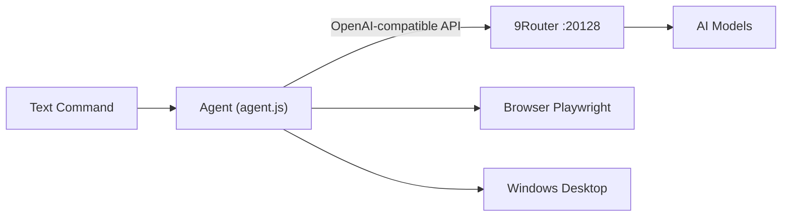

<div align="center">

# Agent Automation

**AI agent for controlling Windows and browser applications through natural-language commands.**

Automatic setup, automatic updates, browser automation, file management, and desktop control in one agent.
Uses [9Router](https://github.com/decolua/9router) as the LLM gateway with model fallback support.


[Showcase](#showcase) • [Features](#features) • [How It Works](#how-it-works) • [Installation](#quick-installation) • [Commands](#example-commands) • [Configuration](#configuration) • [Security](#security)

</div>

---

---

## Showcase

A look at Agent Automation in action, from model testing and the command interface to terminal conversations.

<table>
  <tr>
    <td width="50%" align="center">
      <strong>Model Testing</strong><br>
      
    </td>
    <td width="50%" align="center">
      <strong>Agent Menu</strong><br>
      
    </td>
  </tr>
  <tr>
    <td width="50%" align="center">
      <strong>Natural-Language Commands</strong><br>
      
    </td>
    <td width="50%" align="center">
      <strong>Terminal Chat</strong><br>
      
    </td>
  </tr>
  <tr>
    <td colspan="2" align="center">
      <strong>Terminal Chat — Additional Demo</strong><br>
      
    </td>
  </tr>
</table>

> These previews are animated GIFs generated from the project demo recordings so they can play directly in the GitHub README. Keep the GIF files in `assets/showcase/` when uploading the README.

## Features

|   | Feature                        | Description                                                                                                                                        |
| - | ------------------------------ | -------------------------------------------------------------------------------------------------------------------------------------------------- |
|   | **Real Browser**               | Uses Chrome or Edge installed on the PC. Browser sessions and login state are preserved                                                            |
|   | **Login Flow**                 | Use `/login` to open a login page and sign in manually. The agent does not handle passwords                                                        |
|   | **YouTube Control**            | Search and play videos, skip ads when possible, switch results when playback fails, and control pause, next, seek, mute, and fullscreen            |
|   | **Web Search**                 | Search the web and read information from the returned sources                                                                                      |
|   | **File and Folder Management** | Search across drives, read and write text files, create folders, move files, zip and unzip archives, send files to Recycle Bin, and download files |
|   | **Website Uploads**            | Upload files from different locations through the browser with `y/n` confirmation                                                                  |
|   | **Screen Capture**             | Take screenshots and send them to the selected model for visual analysis                                                                           |
|   | **Mouse and Keyboard**         | Click, double-click, right-click, scroll, type, and press keyboard shortcuts                                                                       |
|   | **Windows Control**            | List, focus, and close windows, control media keys and volume, access clipboard data, and read system information                                  |
|   | **User Interaction**           | Pause and wait when a login, CAPTCHA, or manual verification is required                                                                           |
|   | **Model Fallback**             | Automatically switch to another model through 9Router when a provider reaches its limit                                                            |
|   | **One-Click Setup**            | Install the required components from a single `.bat` file                                                                                          |
|   | **Automatic Updates**          | Check for new releases, download updates, and show release information when the agent starts                                                       |
|   | **Action Confirmation**        | Physical actions such as clicking, typing, opening, writing, deleting, and uploading require `y/n` confirmation by default                         |

---

## How It Works



1. Enter a command using normal language.
2. The agent sends the command and available tools to the selected model through 9Router.
3. The model selects the required tools, such as `find_folder`, `screenshot`, or `click_screen`.
4. The agent executes the selected tools and returns their results to the model.
5. The process continues until the requested task is completed.

The user does not need to know or specify the tool names.

---

## Quick Installation

**Requirements:** Windows 10 or 11 and an internet connection. The remaining components are installed automatically.

1. Download [`start-agent.bat`](start-agent.bat).
2. Place it in any folder, such as Desktop or Downloads.
3. Double-click the file.

On the first run, the launcher will:

* create the `Agent Automation` folder next to the `.bat` file
* install **Node.js** if it is not already available
* install npm dependencies and **Chromium**
* install and start **9Router**
* request the **9Router API key** once and store it locally
* skip the local 9Router setup when **Owner Mode** is configured

On later runs, simply launch `start-agent.bat` again.

> **Note:** Connect at least one provider through the 9Router dashboard (`http://localhost:20128/dashboard`) and create a combo named `bot-combo` using the **Fallback** strategy.

---

## Example Commands

Use normal language. Tool names do not need to be included.

```text
Perintah> cari folder bernama Laporan lalu buka

Perintah> aku pengen nonton youtube, cariin video weak hero

Perintah> pause videonya, lalu naikin volume

Perintah> cari tau cuaca besok di web

Perintah> buka notepad, lalu ketik "catatan rapat hari ini"

Perintah> ambil screenshot lalu jelaskan apa yang terlihat di layar

Perintah> buka https://situs-tujuan.com/upload lalu upload file laporan.pdf
```

---

## Available Tools

<details>
<summary><b>View complete list (39 tools)</b></summary>

| Group                    | Tools                                                                                                                                                           |
| ------------------------ | --------------------------------------------------------------------------------------------------------------------------------------------------------------- |
| Browser                  | `open_url`, `inspect_page`, `get_page_text`, `type_text`, `click`, `upload_file`, `scroll_page`, `web_search`, `download_file`                                  |
| YouTube                  | `youtube_play`, `youtube_control`                                                                                                                               |
| Screen and Input         | `screenshot`, `click_screen`, `scroll_screen`, `type_desktop`, `press_keys`, `wait`                                                                             |
| Windows and Applications | `list_windows`, `focus_window`, `close_window`, `open_path`                                                                                                     |
| Files and Folders        | `find_folder`, `find_file`, `list_dir`, `list_files`, `read_text_file`, `write_text_file`, `make_folder`, `move_path`, `recycle_path`, `zip_path`, `unzip_path` |
| PC                       | `media_key`, `clipboard_get`, `clipboard_set`, `system_info`, `now`                                                                                             |
| Interaction              | `wait_for_user`, `done`                                                                                                                                         |

</details>

---

## Agent Commands

| Command            | Description                                                                       |
| ------------------ | --------------------------------------------------------------------------------- |
| `/login [address]` | Open a login page and let the user sign in manually. The browser session is saved |
| `/baru`            | Show the latest feature list                                                      |
| `/bantuan`         | Show available features and examples                                              |
| `/update`          | Check for updates and restart the agent                                           |
| `/versi`           | Show the current version and check for updates                                    |
| `/reset`           | Clear the current conversation                                                    |
| `exit`             | Exit the agent                                                                    |

---

## Configuration

Configuration is stored in `config.bat` inside the `Agent Automation` folder.

| Variable       | Default                     | Description                                                                          |
| -------------- | --------------------------- | ------------------------------------------------------------------------------------ |
| `ROUTER_KEY`   | Set during setup            | 9Router API key                                                                      |
| `ROUTER_URL`   | `http://localhost:20128/v1` | 9Router API endpoint                                                                 |
| `ROUTER_MODEL` | `bot-combo`                 | Combo or model used by the agent                                                     |
| `SAFE_DIR`     | `upload-folder`             | Default directory for relative file paths. Uploads are not restricted to this folder |
| `AUTO_UPDATE`  | `1`                         | `0` = disable automatic updates and update notifications                             |
| `CONFIRM`      | `1`                         | `1` = ask before physical actions, `0` = run automatically                           |
| `SEARCH_ROOTS` | User folders                | Additional search locations separated by semicolons                                  |
| `UPDATE_URL`   | Owner default               | Custom update source. Usually does not need to be changed                            |

### Additional Commands

```cmd
start-agent.bat reset     :: reset the stored API key
start-agent.bat seturl    :: change the update source
```

---

## Automatic Updates

The update source is already configured in `start-agent.bat`. Users do not need to enter an update URL manually.

| When                           | What happens                                                                                                                                |
| ------------------------------ | ------------------------------------------------------------------------------------------------------------------------------------------- |
| Every `start-agent.bat` launch | Checks the version. If a newer version exists, files are downloaded, dependencies are updated when required, and the changelog is displayed |
| While the agent is running     | Checks for updates every 15 minutes and displays an update notification when a new version is available                                     |
| `/update` is entered           | The agent closes, updates itself, and starts again                                                                                          |
| `notice.txt` is published      | The notice is displayed to users when the agent starts                                                                                      |

If the internet connection is unavailable or an update fails, the current local version continues running and the update will be checked again later.

To disable automatic updates:

```text
AUTO_UPDATE=0
```

Add this to `config.bat`.

### Releasing a New Version

1. Replace `agent.js` in the repository.
2. Increase the number in `version.txt`. This number triggers the update for users.
3. Optionally update `changelog.txt` with the changes.
4. Optionally add an announcement to `notice.txt`.
5. Commit the changes to the repository.

To add another file to the update process, add its filename to `files.txt`, one file per line.

`config.bat` and `start-agent.bat` are intentionally excluded from automatic replacement.

---

## Owner Mode

By default, every user runs their own 9Router instance and provides their own API key.

For shared access, the owner can host a 9Router server and configure `start-agent.bat` before distributing it:

```bat
set "OWNER_ROUTER_URL=https://ai.domainmu.com/v1"
set "OWNER_ROUTER_KEY=sk-key-untuk-user"
```

With these values configured, the launcher skips the local 9Router installation and uses the owner's server instead.

> **Security:** Never publish the owner key in a public GitHub repository. Only distribute it through a controlled copy of `start-agent.bat`.

> **Server security:** Protect the 9Router server, change the dashboard password, avoid exposing the dashboard publicly, use separate keys when possible, and monitor usage.

> **Privacy:** Commands and screenshots can pass through the owner's server. Users should be informed before using Owner Mode.

> **Provider terms:** Shared model access must comply with the terms of the provider and the services connected to 9Router.

---

## Repository Structure

```text
.
├── start-agent.bat   # Installer and launcher
├── agent.js          # Main agent
├── package.json      # Dependencies
├── version.txt       # Version number used for updates
├── files.txt         # Files included in automatic updates
├── changelog.txt     # Changes shown after an update
├── notice.txt        # Owner announcements
└── README.md         # Project documentation
```

---

## Security

This agent has broad access to the local computer. Use it only in an environment you trust.

* **Action confirmation** is enabled by default for clicking, typing, opening files, writing, deleting, and uploading.
* **No unrestricted shell execution tool** is provided.
* The agent can be stopped at any time with `Ctrl + C`.
* **Screenshots may be sent to the selected model provider.** Do not run the agent while passwords, banking information, private conversations, or other sensitive data are visible.
* **The API key is stored as plain text** in `config.bat`. Do not share the `Agent Automation` folder or commit the configuration to a public repository.
* **The update source can change the code executed on the PC.** Use a repository controlled by the owner and enable two-factor authentication on the GitHub account.
* **Third-party providers may have their own restrictions.** Review their terms before using the project for commercial or production workloads.

---

## Troubleshooting

| Problem                                      | Solution                                                                                         |
| -------------------------------------------- | ------------------------------------------------------------------------------------------------ |
| `Node.js` is not detected after installation | Close the current window and run `start-agent.bat` again                                         |
| `Access denied by owner server`              | The key may have been revoked or is invalid. Request an updated `start-agent.bat` from the owner |
| `9Router rejected the API key`               | Run `start-agent.bat reset` and enter a valid key                                                |
| Agent only generates a plan                  | Use a model with tool-calling support and place it near the top of the combo                     |
| Screen clicks are inaccurate                 | Use a vision-capable model and ask the agent to capture a new screenshot                         |
| `9Router is not responding`                  | Open `http://localhost:20128/dashboard` and check whether the service is running                 |

---

## Disclaimer

This project is provided as-is without warranty.

You are responsible for all actions performed by the agent on your computer, the configuration of connected services, API usage, and compliance with the terms of service of the model providers and third-party services you use.

<div align="center">

Built with [9Router](https://github.com/decolua/9router) and [Playwright](https://playwright.dev)

</div>
